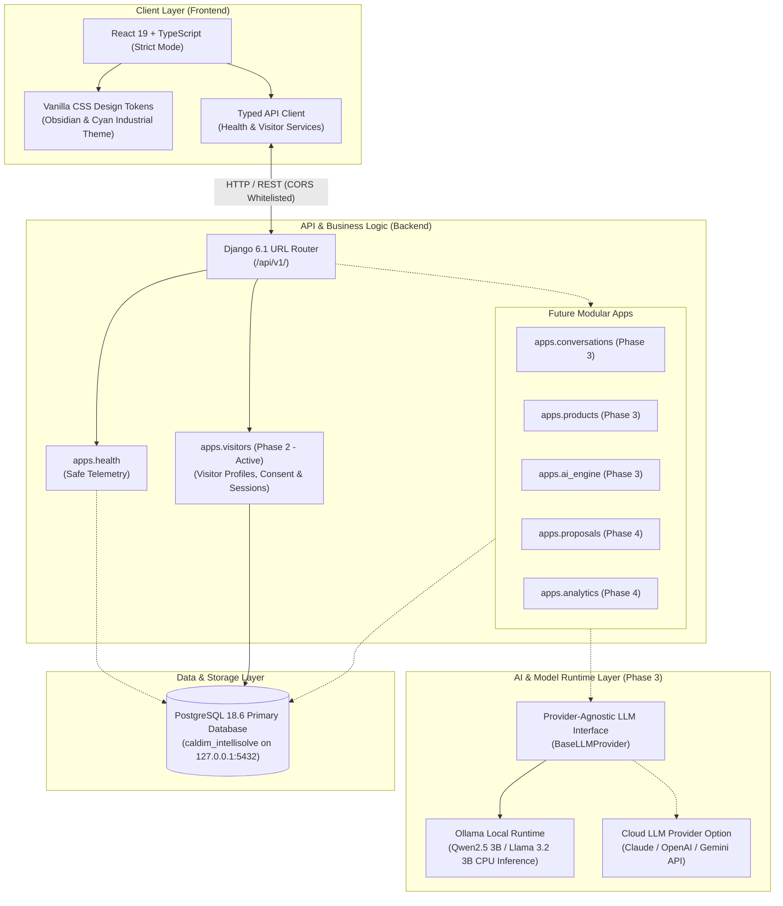

# CALDIM IntelliSolve AI — Architecture Specification

## 1. System Overview

CALDIM IntelliSolve AI is an industrial AI consultation platform designed to help manufacturing businesses discover CALDIM products, diagnose industrial equipment and automation challenges, evaluate ROI, and generate custom proposals through a conversational visitor experience.



---

## 2. Component Responsibilities

### 2.1 Frontend (`frontend/`)
- **Technology Stack**: React 19, TypeScript with strict mode enabled, Vite bundler, Vanilla CSS with custom properties.
- **Visual Design**: High-tech industrial aesthetic inspired by industrial automation panels (deep obsidian/carbon canvas, precision cyan and emerald telemetry glows, glassmorphism cards).
- **Separation of Concerns**:
  - `src/api/client.ts`: Centralized typed HTTP client with latency measurement and error normalization.
  - `src/api/health.ts`: System status and health probe caller.
  - `src/api/visitor.ts`: Typed visitor profile, consent, and session endpoints.
  - `src/types/visitor.ts`: Strict TypeScript contracts for visitor data models.
  - `src/hooks/`: Decoupled reactive hooks (`useSystemHealth.ts`).
  - `src/components/ui/`: Atomic UI primitives (`Button`, `Card`, `Badge`, `StatusDot`).
  - `src/features/system-status/`: Telemetry, diagnostics, hardware profiling, and roadmap views.

### 2.2 Backend (`backend/`)
- **Technology Stack**: Python 3.14, Django 6.1, Django REST Framework 3.18, psycopg 3.3.6, django-cors-headers, python-dotenv.
- **Routing & Versioning**: Unified API root at `/api/v1/`.
- **System Health Service (`apps/health/`)**: Provides `GET /api/v1/health/` returning safe service identification.
- **Visitor Management (`apps/visitors/`)**:
  - `Visitor`: Professional profile with UUID primary key, optional/incomplete fields for progressive conversational onboarding, completion state, and SHA-256 access token hash.
  - `VisitorConsent`: Explicit GDPR-compliant consent categories (`essential`, `email_contact`, `analytics`) with database-enforced unique active constraints and atomic revocation tracking.
  - `VisitorSession`: Consultation session records linking ephemeral kiosk/browser visits to persistent visitor profiles with sanitized operational metadata.
- **Database Architecture**: PostgreSQL 18.6 connected as primary database via application role `caldim_user`. Zero fallback to SQLite.

---

## 3. Visitor API Specification (Phase 2 Contract)

All visitor routes live under `/api/v1/visitors/`.

### 3.1 Create Visitor Profile (`POST /api/v1/visitors/`)
Validates and persists a new visitor profile. Generates a cryptographically secure ownership token.

**Request Body:**
```json
{
  "display_name": "Dr. Aris Thorne",
  "profession": "Chief Automation Architect",
  "company_name": "Apex Precision Machinery",
  "industry": "Industrial Robotics",
  "department": "Advanced Automation",
  "responsibilities": "Evaluating predictive maintenance for heavy forging lines",
  "email": "aris.thorne@apex-machinery.example.com",
  "phone": "+1-555-782-9901",
  "initial_consents": [
    {"category": "essential", "status": "granted", "policy_version": "1.0"},
    {"category": "email_contact", "status": "granted", "policy_version": "1.0"}
  ]
}
```

**Response (HTTP 201 Created):**
```json
{
  "visitor": {
    "id": "44b74ade-1288-4811-96f6-4a5cb7d9a258",
    "display_name": "Dr. Aris Thorne",
    "profession": "Chief Automation Architect",
    "company_name": "Apex Precision Machinery",
    "industry": "Industrial Robotics",
    "department": "Advanced Automation",
    "responsibilities": "Evaluating predictive maintenance for heavy forging lines",
    "email": "aris.thorne@apex-machinery.example.com",
    "phone": "+1-555-782-9901",
    "profile_completion_status": "complete",
    "created_at": "2026-10-26T11:41:40.589309Z",
    "updated_at": "2026-10-26T11:41:40.589309Z"
  },
  "access_token": "k488r8tU31r0-F9226q089c25y3k3f-...",
  "message": "Visitor profile created successfully."
}
```
*Note: Public listing (`GET /api/v1/visitors/`) returns `HTTP 405 Method Not Allowed`.*

### 3.2 Retrieve Visitor Profile (`GET /api/v1/visitors/{visitor_id}/`)
Requires header: `X-Visitor-Token: <access_token>`.
Without token or with invalid token, returns `HTTP 401 Unauthorized`.

### 3.3 Create Consultation Session (`POST /api/v1/visitors/{visitor_id}/sessions/`)
Requires header: `X-Visitor-Token: <access_token>`.

**Request Body:**
```json
{
  "metadata": {
    "kiosk_id": "KIOSK-BAY-03",
    "client_viewport": "1920x1080"
  }
}
```

**Response (HTTP 201 Created):**
```json
{
  "id": "ae5a96f6-0a26-4f16-9b72-3bee0aab2976",
  "visitor_id": "44b74ade-1288-4811-96f6-4a5cb7d9a258",
  "status": "active",
  "created_at": "2026-10-26T11:41:40.612000Z",
  "last_activity_at": "2026-10-26T11:41:40.612000Z",
  "ended_at": null,
  "metadata": {
    "kiosk_id": "KIOSK-BAY-03",
    "client_viewport": "1920x1080"
  }
}
```

### 3.4 Record Explicit Consent (`POST /api/v1/visitors/{visitor_id}/consent/`)
Requires header: `X-Visitor-Token: <access_token>`.
Atomically marks any previous active consent record for the specified category as revoked and inserts the new status.

### 3.5 Revoke Visitor Token (`POST /api/v1/visitors/{visitor_id}/revoke-token/`)
Requires header: `X-Visitor-Token: <access_token>`.
Immediately sets `token_revoked_at` in PostgreSQL. All subsequent requests using this token are rejected with `HTTP 401 Unauthorized`.

---

## 4. Security & Privacy Design

1. **Zero Raw Token Persistence**: Raw ownership tokens are never stored in PostgreSQL. Only their SHA-256 digest (`access_token_hash`) is indexed.
2. **Constant-Time Verification**: Candidate token hashes are validated against the stored digest using `secrets.compare_digest()` to eliminate timing attack side-channels.
3. **Token Expiry & Revocation**: Tokens have an explicit creation timestamp (`token_created_at`) with configurable TTL (`VISITOR_TOKEN_TTL_DAYS=30`), and support immediate revocation (`token_revoked_at`).
4. **Anonymous Rate Limiting**: The public visitor creation endpoint (`POST /api/v1/visitors/`) is throttled (default: `10/minute` via `ScopedRateThrottle`). Behind reverse proxies, `NUM_PROXIES` configures trusted IP extraction from `X-Forwarded-For`.
5. **Anti-Guessing Authorization**: Knowing or guessing a visitor UUID grants zero access. All profile, session, and consent operations require a matching `X-Visitor-Token`.
6. **No Public Visitor Listing**: `GET /api/v1/visitors/` is disabled (405 Method Not Allowed) to prevent bulk harvesting of visitor information.
7. **Independent Consent Tracking**: Email consent is never inferred from the presence of an email address.
8. **Operational Metadata Filtering**: Session metadata sanitizes and drops sensitive keys (`password`, `token`, `secret`, `credit_card`, `ssn`).
9. **Least-Privilege Database & Isolated Tests**: Application database role `caldim_user` has zero superuser or CREATEDB privileges. Automated tests run against isolated databases (`test_caldim_intellisolve` or in-memory test runner) without mutating live development records.

---

## 5. Administrative Access & Django Superuser

Authorized staff can inspect records via Django Admin at `http://127.0.0.1:8000/admin/`.

To create a local administrative user on this workstation:
```powershell
backend\.venv\Scripts\python.exe backend\manage.py createsuperuser
```
Sensitive contact information (email, phone) is collapsed by default in list views and audit fields are strictly read-only.
