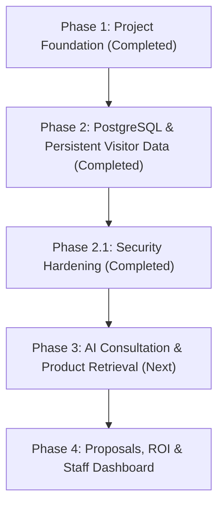

# CALDIM IntelliSolve AI — Implementation Roadmap

This document outlines the structured development phases for the CALDIM IntelliSolve AI platform. Each phase builds systematically on the previous foundation with strict entry and exit criteria.

---

## Phase 1: Project Foundation (Completed)

**Objective**: Establish a secure monorepo foundation with React + TypeScript frontend, Django REST Framework backend, environment-driven configuration, and verifiable health telemetry.

### Deliverables Completed:
- Monorepo structure inside `Caldim_IntelliSolve/`.
- Frontend: Vite + React 19 + TypeScript (strict mode enabled).
- Design System: Custom properties tokens (`tokens.css`), industrial dark aesthetics.
- Backend: Django 6.1 + Django REST Framework 3.18 with versioned `/api/v1/` namespace.
- Health Endpoint: `GET /api/v1/health/` returning safe service identification.
- Hardware & AI Profiling: Assessment of host CPU, RAM, and graphics capabilities for future Ollama runtime.

---

## Phase 2: PostgreSQL & Persistent Visitor Data (Completed)

**Objective**: Connect PostgreSQL 18 as the real application database and implement persistent visitor profiles, explicit consent tracking, and consultation sessions.

### Deliverables Completed:
- Configured PostgreSQL 18.6 primary database on `127.0.0.1:5432` with application role `caldim_user`.
- Removed SQLite fallback; strict failure if database is inaccessible.
- Created `apps.visitors` with Django ORM models:
  - `Visitor`: UUID primary key, progressive conversational onboarding support, profile completion states, SHA-256 access token hash.
  - `VisitorConsent`: Explicit consent categories (`essential`, `email_contact`, `analytics`) with unique active constraints and atomic revocation tracking.
  - `VisitorSession`: Consultation session records linking kiosk/browser sessions with operational metadata sanitization.
- Migrations applied against PostgreSQL (`0001_initial.py`).
- REST endpoints under `/api/v1/visitors/`:
  - `POST /api/v1/visitors/`: Visitor creation with access token generation.
  - `GET /api/v1/visitors/`: Blocked (405 Method Not Allowed) to prevent public harvesting.
  - `GET /api/v1/visitors/{visitor_id}/`: Protected profile retrieval via `X-Visitor-Token`.
  - `POST /api/v1/visitors/{visitor_id}/sessions/`: Session creation with token validation.
  - `POST /api/v1/visitors/{visitor_id}/consent/`: Atomic consent recording and revocation.
- Django Admin registration with collapsible PII and read-only audit fields.
- Direct database verification: Verified raw SQL insertion, retrieval, and persistence across process restarts.
- Frontend typed API client and interfaces in `frontend/src/types/visitor.ts` and `frontend/src/api/visitor.ts`.

---

## Phase 2.1: Security Hardening (Completed)

**Objective**: Address audit findings by implementing API rate limiting, constant-time token verification, token lifecycle management (expiry & revocation), isolated test database configuration, and a comprehensive privacy and authorization review.

### Delivered Capabilities:
- **API Rate Limiting**:
  - Configurable anonymous rate limit on visitor creation (`POST /api/v1/visitors/`) using Django REST Framework's `ScopedRateThrottle` (`10/minute` default via `THROTTLE_RATE_VISITOR_CREATE`).
  - Safe reverse proxy support with `NUM_PROXIES` header extraction.
  - Authenticated visitor operations remain unthrottled.
- **Constant-Time Token Verification**:
  - Replaced digest equality with `secrets.compare_digest` in `Visitor.verify_access_token` to mitigate timing side-channel attacks.
- **Token Expiry & Revocation**:
  - Added indexed audit fields `token_created_at` and `token_revoked_at` to `Visitor` model.
  - Configurable expiration window via `VISITOR_TOKEN_TTL_DAYS` (default 30 days).
  - Explicit revocation method `visitor.revoke_access_token()`.
  - Secure revocation endpoint `POST /api/v1/visitors/{visitor_id}/revoke-token/` (requires existing token authorization).
  - Zero lockouts / data loss: migration `0002` safely defaulted `token_created_at` and left `token_revoked_at=None` for all existing visitor profiles.
- **Automated Test Database Configuration**:
  - Identified root cause of `permission denied to create database`: application user `caldim_user` is a least-privilege role without `CREATEDB`.
  - Configured test connection parameters (`TEST_DB_NAME`, `TEST_DB_USER`, `TEST_DB_PASSWORD`) in `backend/core/settings.py`.
  - Documented one-time pre-provisioning for PostgreSQL test runs (`python manage.py test --keepdb`).
  - Added `backend/core/test_settings.py` for isolated automated unit and API testing (`python manage.py test --settings=core.test_settings`).
- **Privacy & Authorization Verification**:
  - Verified PII masking, sensitive session metadata key filtering (`FORBIDDEN_METADATA_KEYS`), and exception masking.

---

## Phase 3: AI Consultation Engine & Product Retrieval (Pending Approval)

**Objective**: Integrate Ollama local LLM runtime via a provider-agnostic interface and ingest verified CALDIM product specifications.

### Prerequisites:
- Completion and sign-off on Phase 2.
- Local Ollama runtime installed on host workstation.

### Planned Modules:
- `backend/apps/ai_engine/`:
  - `BaseLLMProvider` interface implementation.
  - `OllamaLocalProvider` connector (targeting `qwen2.5:3b` or `llama3.2:3b` for 4-core Intel CPU).
  - Industrial prompt templates adapted to visitor profession (Plant Manager, Procurement, Maintenance Engineer, Automation Specialist).
  - Streaming token responses via Server-Sent Events (SSE) or WebSockets.
- `backend/apps/products/`:
  - CALDIM verified technical knowledge base and product catalog schema.
  - Context-aware retrieval engine to augment LLM answers with verified specs.

---

## Phase 4: Proposals, ROI & Staff Dashboard (Roadmap)

**Objective**: Generate industrial equipment ROI calculations, structured proposals, and provide a dedicated staff portal for lead management.

### Prerequisites:
- Completion of Phase 3.

### Planned Modules:
- `backend/apps/proposals/`:
  - Industrial ROI calculation engine (energy savings, downtime reduction, throughput improvement).
  - Exportable proposal generation (PDF / web summary).
- `backend/apps/analytics/` & Staff Portal:
  - Lead qualification dashboard for CALDIM sales engineers.
  - Visitor conversation audit and follow-up queue.
  - Platform conversion metrics and product interest analytics.

---

## Dependency Graph

